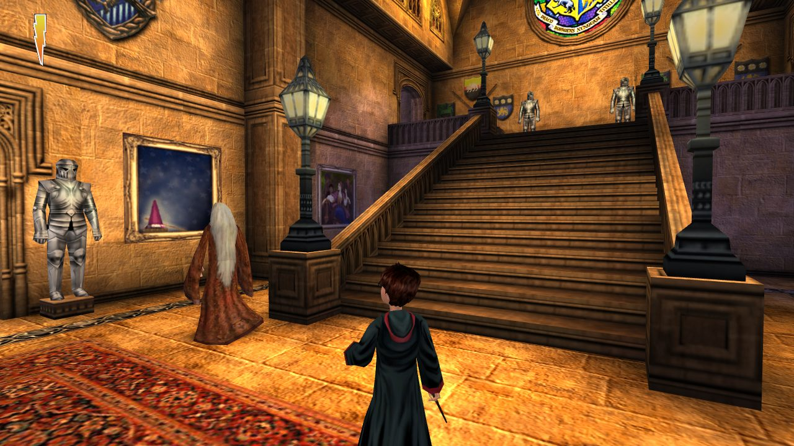
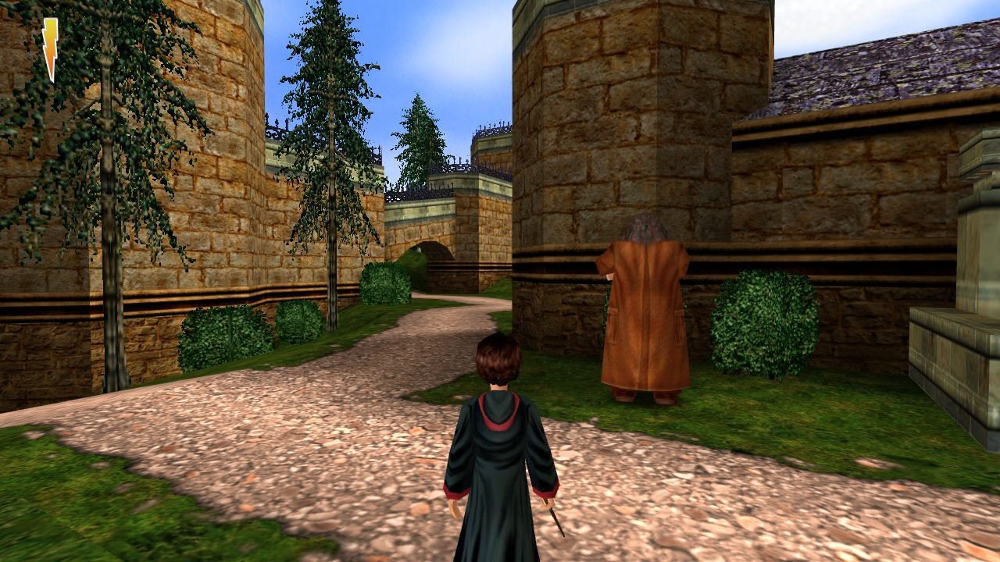
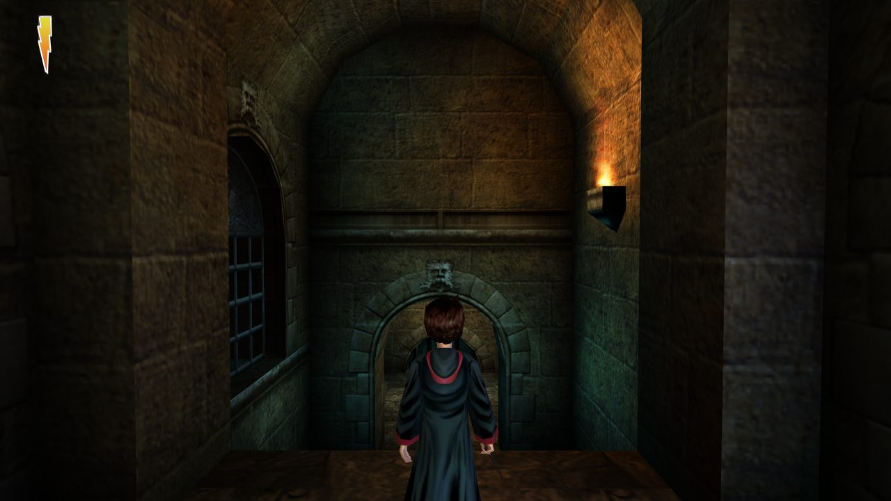
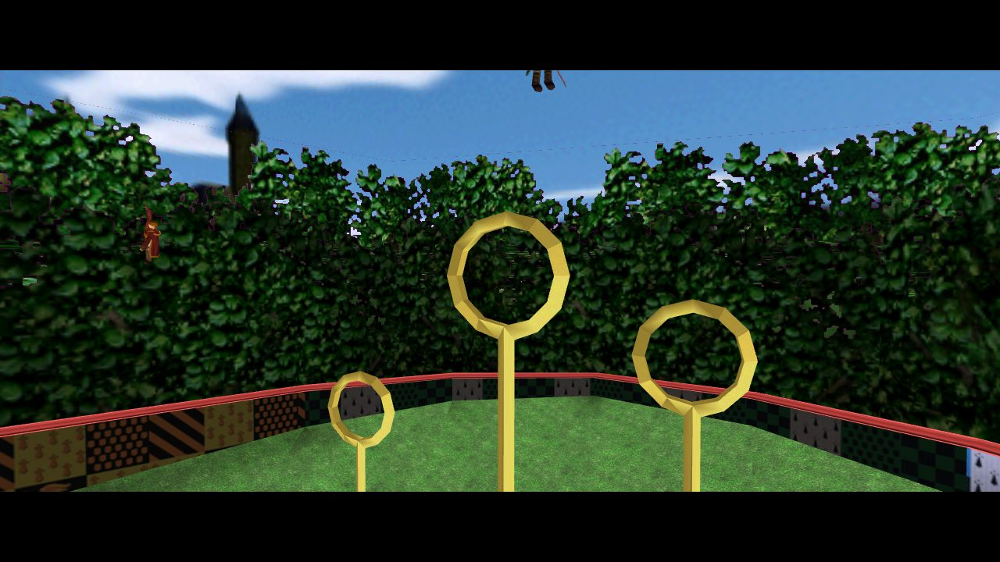

# MorphagusEngine

[English](README.md) | **中文**

《哈利·波特与魔法石》（PC 版，2001）所用 Unreal Engine 1 运行时的 Web 重新实现。它读取游戏自己的数据包，在浏览器里
运行游戏原有的 UnrealScript 脚本：脚本虚拟机、物理与碰撞、骨骼动画、基于 three.js / WebGL 的渲染、音频，以及
游戏的菜单、存档和关卡流程。

| | |
|---|---|
|  |  |
|  |  |

*截图为英文版在浏览器中运行的画面。*

> **本仓库不包含任何游戏资产。** 地图、贴图、声音、音乐、模型、脚本包以及游戏的其他任何文件都没有收录。
> 运行时需要你自己安装的正版游戏，引擎在运行时从该目录读取数据。

## 功能

- Unreal 数据包读取（名称表、导入/导出、属性、贴图、模型、声音、音乐、关卡）
- UnrealScript 虚拟机：状态与 latent 函数、Core / Engine 原生函数以及《哈利·波特》自己的原生函数
- 物理：行走、下落、飞行、游泳、机关（Mover）、推挤、触碰 / 碰撞事件、射线检测
- 渲染：带光照贴图和动态光的 BSP 关卡、骨骼模型、精灵与粒子系统、程序贴图、体积雾、镜面与传送区、贴花与阴影
- 音频：3D 定位音效、音乐、对白
- 游戏原有的菜单和 HUD、过场动画、关卡切换、存档（浏览器 localStorage）
- 画面自适应窗口大小（宽屏时左右可以看到更多）
- 调试工具：叠加信息、Actor 检视、带复现链接的状态快照

`docs/engine-parity.md` 列出了每个引擎模块及其与参考行为的核对情况。

## 环境要求

- Node.js 18 或更新版本
- 已安装的 PC 版《哈利·波特与魔法石》（包含 `Maps/`、`System/`、`Textures/`、`Sounds/`、`Music/` 的目录）

## 运行

```bash
npm install
HP_GAME_DIR=/path/to/your/HarryPotter npm run dev   # 默认：../HarryPotter
```

打开 http://localhost:5173/ 进入主菜单，或用 `?map=Lev_Tut1` 直接进入某张地图。

| URL 参数 | 作用 |
|---|---|
| `map=<名称>` | 直接进入该地图 |
| `lang=int` | 英文（默认为繁体中文版） |
| `debug=1` | 调试叠加信息：F8 开关、F9 保存快照、F10 锁定目标 |
| `aspect=4:3` | 保持原版 4:3 画面 |
| `doors=1` | 开门模式：施法会打开 Harry 瞄准的门（游戏中输入 `alohomora` 可切换） |

操作沿用游戏自己的按键设置（`System/DefUser.ini`），另外空格键也可以跳跃。

## 静态部署

```bash
tools/package.sh -l tra        # 脚本 + 引擎所需的数据，打成 zip（-l tra|int|all）
tools/package.sh -s            # 只打包脚本（index.html 和 assets/）
```

解压到任意静态 Web 服务器目录，打开 `index.html` 即可。完整包里含有你的游戏数据，这样的站点请只在私下使用。

## 测试

```bash
npm test                                    # 引擎一致性与玩法测试（需要游戏目录）
node tools/naive/run.mjs Lev_Tut1 Lev_Tut1   # 按键输入驱动的自动通关机器人
```

## 许可证

引擎代码以 [MIT 许可证](LICENSE) 发布，仅覆盖本仓库的代码：《哈利·波特》、游戏本身、游戏数据和脚本归各自的权利方
所有，不属于本仓库。这是非官方的爱好者项目，与华纳兄弟、艺电（EA）或 KnowWonder 均无关联，也未获其认可。
